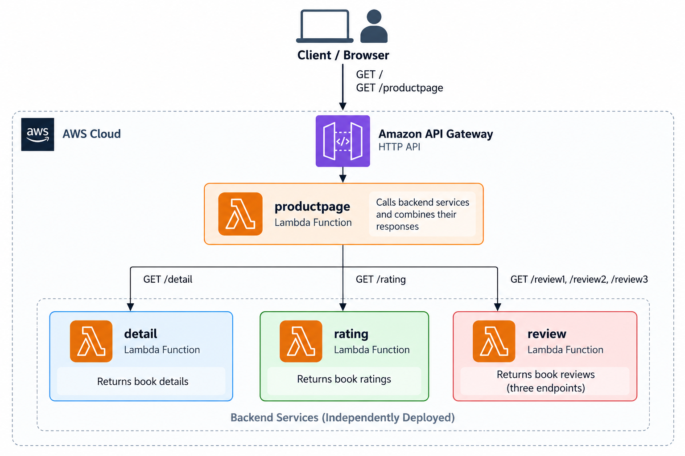
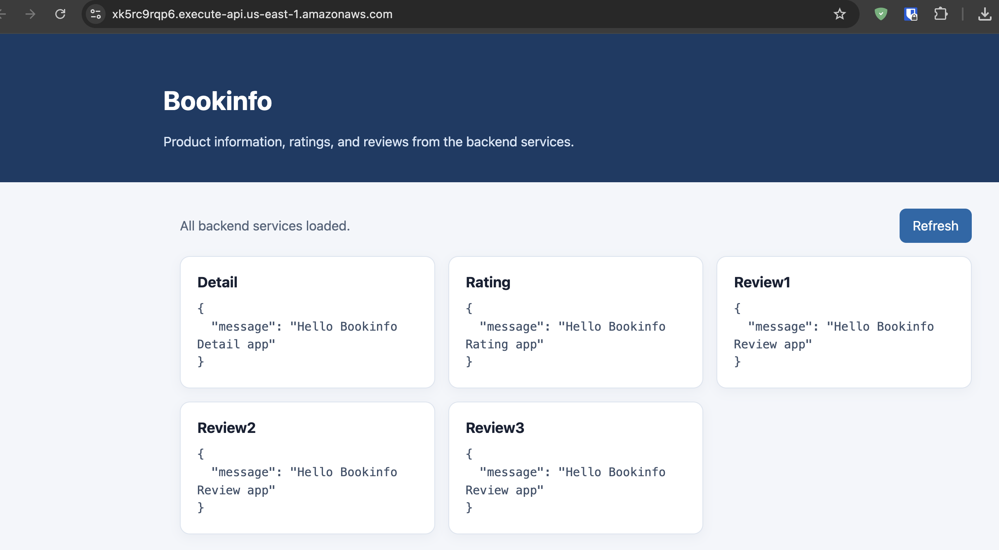

# Bookinfo Serverless

A learning/demo project that shows how to deploy a small microservices-style application using **AWS Lambda, Amazon API Gateway, and the Serverless Framework**.

Inspired by the [Istio Bookinfo Application](https://istio.io/latest/docs/examples/bookinfo/), it demonstrates independently deployed Lambda services communicating over HTTP APIs. The `productpage` service calls the backend APIs and combines their responses into a browser page or JSON response. The backend handlers currently return greeting placeholders; this repository demonstrates service deployment and integration rather than a complete book catalog.

## Architecture



The application consists of four independent services:

| Service | API route(s) | Current behavior |
| --- | --- | --- |
| `productpage` | `GET /`, `GET /productpage` | Serves the UI at `/`; aggregates backend responses as JSON at `/productpage`. |
| `detail` | `GET /detail` | Returns a greeting placeholder for the detail service. |
| `rating` | `GET /rating` | Returns a greeting placeholder for the rating service. |
| `review` | `GET /review1`, `GET /review2`, `GET /review3` | Three endpoints that return greeting placeholders. |

### How it works

1. A client sends a request through Amazon API Gateway.
2. API Gateway invokes the `productpage` Lambda function.
3. `productpage` requests the detail endpoint, the rating endpoint, and all three review endpoints concurrently.
4. Each backend Lambda returns its response.
5. The JSON endpoint combines the responses; the browser UI displays them in service cards.

Each service is deployed independently using the Serverless Framework.

## Example result



> **Note:** The backend services currently return simple greeting messages for integration testing rather than actual book details, ratings, or reviews.

## Project structure

```text
pov-serviceless-bookinfo/
├── detail/
│   ├── handler.js
│   ├── README.md
│   └── serverless.yml
├── rating/
│   ├── handler.js
│   ├── README.md
│   └── serverless.yml
├── review/
│   ├── handler.js
│   ├── README.md
│   └── serverless.yml
├── productpage/
│   ├── handler.js
│   ├── README.md
│   └── serverless.yml
├── architecture.png
├── result.png
├── .gitignore
└── README.md
```

## Prerequisites

- AWS account
- Node.js and npm
- AWS CLI configured with valid credentials
- Serverless Framework installed

For installation and setup, see the [Serverless Framework Getting Started Guide](https://www.serverless.com/framework/docs/getting-started).

## Deploy this project

Install the Serverless Framework and configure AWS credentials before deploying.
Clone the repository and change to its root directory:

```sh
git clone https://github.com/iamlwinkoko/pov-serviceless-bookinfo.git
cd pov-serviceless-bookinfo
```

Deploy the three backend services first, and use `serverless info` in each
directory to find its API Gateway URL:

```sh
cd detail
serverless deploy
serverless info

cd ../rating
serverless deploy
serverless info

cd ../review
serverless deploy
serverless info
```

Before deploying `productpage`, update `DETAIL_API_URL`, `RATING_API_URL`, and
`REVIEW_API_URL` in [`productpage/serverless.yml`](./productpage/serverless.yml)
to the backend API base URLs reported by `serverless info`. Use base URLs
without route paths; productpage appends `/detail`, `/rating`, and the review
routes itself.

Then deploy productpage:

```sh
cd ../productpage
serverless deploy
serverless info
```

## Optional: Create a new Serverless service

The repository already contains the four services. Use the interactive CLI only
if you want to scaffold an additional service from scratch. From the parent
directory where you want its folder created, run:

```sh
serverless
```

In the prompts, select the **AWS Node.js HTTP API** template, enter a project
name, choose **Create a new app**, and enter an app name. Then deploy the
generated service:

```sh
cd projectname
serverless deploy
serverless info
```

Replace `projectname` with the name you selected. Remove that service's AWS
resources with `serverless remove` from its directory when you no longer need
it.

## Testing

In the `productpage` directory, get the API Gateway base URL:

```sh
serverless info
```

Open `<base-url>/` in a browser to view the UI. To test the aggregated JSON
API, replace the example URL below with the API Gateway base URL from
`serverless info`:

```sh
PRODUCTPAGE_URL="https://your-api-id.execute-api.your-region.amazonaws.com"
curl "$PRODUCTPAGE_URL/productpage"
```

Replace the example `PRODUCTPAGE_URL` with the API Gateway base URL from your
deployment. The screenshot shows an example integration test; its placeholder
responses are not real book details, ratings, or reviews.

## Cleanup

Remove the deployed services when testing is complete to avoid unnecessary AWS
charges. This deletes their Lambda functions, API Gateway APIs, and related
CloudFormation stacks, so the deployed endpoints will no longer work.

From the repository root:

```sh
cd productpage && serverless remove
cd ../review && serverless remove
cd ../rating && serverless remove
cd ../detail && serverless remove
```

## References

- [Istio Bookinfo Application](https://istio.io/latest/docs/examples/bookinfo/)
- [AWS Lambda documentation](https://docs.aws.amazon.com/lambda/)
- [Amazon API Gateway documentation](https://docs.aws.amazon.com/apigateway/)
- [Serverless Framework documentation](https://www.serverless.com/framework/docs/)
